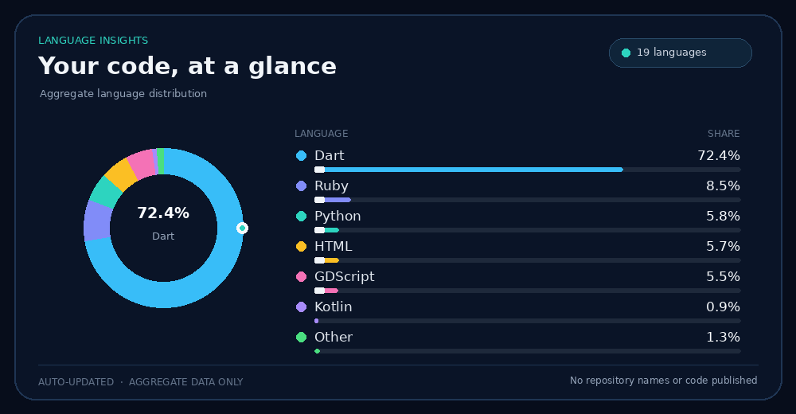
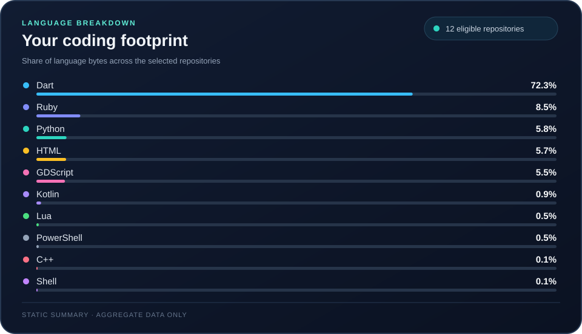

<!-- Animated profile header -->

  
  
  

    
    
    
  

---

## About me · Sobre mim

I build practical software that solves real problems, with a focus on maintainability, privacy, and offline-first workflows.

Desenvolvo software prático para resolver problemas reais, com foco em manutenção simples, privacidade e funcionamento offline.

## Featured project · Projeto em destaque

  

**[Poliglota — Offline localization toolkit](https://github.com/jorgeezequiel/poliglota)**

A reusable tool for validating and synchronizing localization files, helping reduce repetitive translation work and supporting offline translation engines.

Ferramenta reutilizável para validar e sincronizar arquivos de localização, reduzir trabalho repetitivo e dar suporte a motores de tradução offline.

## Published app · Aplicativo publicado

### [QuestLog — Personal finance](https://play.google.com/store/apps/details?id=com.questlog.finance)

A personal finance app available on Google Play.

Aplicativo de finanças pessoais disponível na Google Play.

[View on Google Play · Ver na Google Play](https://play.google.com/store/apps/details?id=com.questlog.finance)

## Language statistics · Estatísticas de linguagens

These animated statistics aggregate language data from eligible public repositories and explicitly authorized private repositories. Repository names, URLs, descriptions, and per-repository data are never published.

Estas estatísticas animadas agregam dados de linguagens de repositórios públicos elegíveis e repositórios privados explicitamente autorizados. Nomes, URLs, descrições e dados individuais dos repositórios nunca são publicados.

<!-- PROFILE-STATS:START -->

<!-- PROFILE-STATS:END -->

  Updated daily by GitHub Actions · Atualizado diariamente pelo GitHub Actions · Manual run available · Execução manual disponível

---

  

